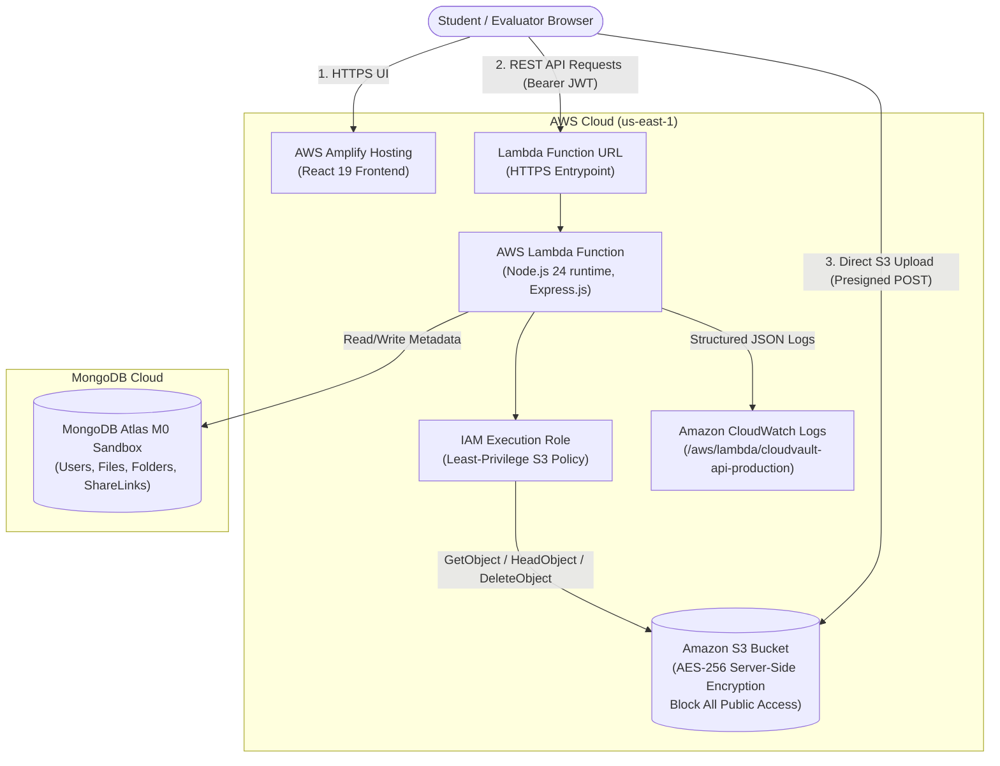

# CloudVault: AWS & MongoDB Atlas Deployment Guide

This comprehensive, step-by-step guide is written specifically for students and engineers deploying **CloudVault** to Amazon Web Services (AWS) and MongoDB Atlas. Follow these exact instructions to deploy both the serverless backend (AWS Lambda + Amazon S3) and the single-page frontend (AWS Amplify Hosting).

---

## Architecture Diagram



---

## Section 1: Prerequisites & Tooling Installation

Before deploying, ensure you have the following CLI utilities installed on your machine:

1. **Node.js 20+**: Verify via `node -v` and `npm -v`.
2. **Git**: Verify via `git --version`.
3. **AWS CLI v2**:
   - Download from: [https://aws.amazon.com/cli/](https://aws.amazon.com/cli/)
   - Verify: `aws --version`
4. **AWS SAM CLI** (Serverless Application Model):
   - Download from: [https://docs.aws.amazon.com/serverless-application-model/latest/developerguide/install-sam-cli.html](https://docs.aws.amazon.com/serverless-application-model/latest/developerguide/install-sam-cli.html)
   - Verify: `sam --version`

---

## Section 2: MongoDB Atlas Free Database Setup

1. **Create an Account**: Go to [https://www.mongodb.com/cloud/atlas](https://www.mongodb.com/cloud/atlas) and sign up for a free account.
2. **Create a Free Cluster**:
   - Choose **Deploy a Database** &rarr; select **M0 Free Tier** (Shared RAM, 512 MB storage).
   - Provider: **AWS**, Region: **us-east-1 (N. Virginia)** (keep in the same region as Lambda to reduce latency).
   - Cluster Name: `CloudVaultCluster`.
   - Click **Create Deployment**.
3. **Configure Database User**:
   - In the Quickstart modal, enter a Username (e.g., `cloudvault_admin`) and generate a secure password.
   - **Important**: Save this password securely.
4. **Network Access / IP Allowlist**:
   - > [!WARNING]
   - > **Academic Demo Security Notice**: AWS Lambda uses a dynamic pool of shared IP addresses unless placed inside a VPC with a NAT Gateway (which costs ~\$32/month). For a zero-cost academic demonstration, you must allow access from anywhere (`0.0.0.0/0`) in MongoDB Atlas.
   - Go to **Network Access** &rarr; click **Add IP Address** &rarr; select **Allow Access From Anywhere** (`0.0.0.0/0`).
   - Add a comment: `Temporary Academic Demo - Delete after evaluation`.
   - Click **Confirm**.
5. **Get Connection String**:
   - Go to **Database** &rarr; click **Connect** &rarr; choose **Drivers** (Node.js).
   - Copy the URI string:
     ```
     mongodb+srv://cloudvault_admin:<password>@cloudvaultcluster.xxxxx.mongodb.net/cloudvault?retryWrites=true&w=majority
     ```
   - Replace `<password>` with your actual password and ensure the database name is `cloudvault`.

---

## Section 3: AWS Account Preparation & Billing Safeguards

1. **Create IAM Deployment User**:
   - Log into AWS Management Console &rarr; Navigate to **IAM** &rarr; **Users** &rarr; **Create user**.
   - User name: `cloudvault-deployer`.
   - Attach policies directly: `AdministratorAccess` (used for deployment orchestration; Lambda runtime will receive its own narrow role).
   - Go to the user &rarr; **Security credentials** &rarr; **Create access key** &rarr; choose **Command Line Interface (CLI)**.
   - Download the CSV containing `Access key ID` and `Secret access key`.
2. **Configure AWS CLI**:
   ```bash
   aws configure
   # AWS Access Key ID: <Your-Access-Key>
   # AWS Secret Access Key: <Your-Secret-Key>
   # Default region name: us-east-1
   # Default output format: json
   ```
3. **Billing Alerts & Zero-Cost Safeguards**:
   - Go to AWS Console &rarr; **Billing and Cost Management** &rarr; **Budgets**.
   - Click **Create budget** &rarr; choose **Zero spend budget** (or Maximum \$5.00/month).
   - Enter your email address to receive immediate alerts if any charges occur.

---

## Section 4: AWS SAM Backend Deployment

The backend uses AWS SAM to automatically create:
- Private Amazon S3 bucket with AES-256 encryption & public access blocked
- S3 CORS rules for direct browser uploads
- IAM execution role with least-privilege S3 and CloudWatch access
- AWS Lambda function running Node.js 24 with Function URL enabled

### Step 4.1: Build the Application
In your project root directory (`C:\Users\linge\Desktop\CloudVault`):
```bash
sam build
```

### Step 4.2: Deploy via Guided Prompt
```bash
sam deploy --guided
```

You will be prompted for parameter values:
- **Stack Name**: `cloudvault-backend`
- **AWS Region**: `us-east-1`
- **Parameter MongoDBUri**: `<Paste your full MongoDB Atlas connection string>`
- **Parameter JWTSecret**: `<Enter a random string at least 64 characters long>`
- **Parameter AllowedOrigins**: `http://localhost:5173` *(We will update this with the Amplify URL in Section 9)*
- **Parameter Environment**: `production`
- **Confirm changes before deploy**: `y`
- **Allow SAM CLI IAM role creation**: `Y`
- **Disable rollback**: `N`
- **Save arguments to configuration file**: `Y`

SAM will create the CloudFormation stack and display the **Outputs**:
```
CloudVaultFunctionUrl = https://xxxxxxxxxxxxxxxxxxxx.lambda-url.us-east-1.on.aws/
CloudVaultBucket      = cloudvault-files-123456789012-us-east-1
```
**Save these output values.**

---

## Section 5: Verify S3 Private Bucket & CORS

The SAM template automatically provisions the S3 bucket with strict security:
1. Go to AWS Console &rarr; **Amazon S3** &rarr; find your bucket `cloudvault-files-...`.
2. In the **Permissions** tab:
   - **Block public access**: `On` (All 4 settings enabled).
   - **Bucket Policy**: Clean (No public read access).
   - **Cross-origin resource sharing (CORS)**: Contains rules allowing `PUT` and `POST` from your web app.

---

## Section 6: AWS Amplify Frontend Deployment

Deploy the React frontend using AWS Amplify Hosting directly from GitHub:

1. **Push your code to GitHub**:
   ```bash
   git init
   git add .
   git commit -m "feat: complete CloudVault application"
   git branch -M main
   git remote add origin https://github.com/<your-username>/CloudVault.git
   git push -u origin main
   ```
2. **Open AWS Amplify Console**:
   - Go to AWS Management Console &rarr; **AWS Amplify** &rarr; click **Deploy an app**.
   - Select **GitHub** &rarr; authenticate and select your `CloudVault` repository and `main` branch.
3. **Configure App Build Settings**:
   - Amplify will automatically detect the root `amplify.yml`.
   - Ensure the monorepo root settings point to the `client` directory as configured in `amplify.yml`.
4. **Set Environment Variable in Amplify**:
   - Expand **Advanced settings** or go to **Environment variables**.
   - Add:
     - **Key**: `VITE_API_BASE_URL`
     - **Value**: `<Your LambdaFunctionUrl from SAM Output, without trailing slash>` (e.g. `https://xxxxxxxx.lambda-url.us-east-1.on.aws`)
5. **Click Save and Deploy**:
   - Amplify will execute `preBuild`, `npm run build`, and deploy the static assets to Amazon CloudFront CDN edge servers.
   - Once complete, Amplify provides your live domain: `https://main.d123456abcdef.amplifyapp.com`.

---

## Section 7: Connect Frontend and Backend (Close the Loop)

Now that you have your production Amplify domain:

1. Update the CORS allowed origins on your Lambda function:
   - Run:
     ```bash
     sam deploy --parameter-overrides AllowedOrigins="http://localhost:5173,https://main.d123456abcdef.amplifyapp.com"
     ```
   - Or in the AWS Lambda Console &rarr; `cloudvault-api-production` &rarr; **Configuration** &rarr; **Function URL** &rarr; **Configure CORS** &rarr; add your Amplify URL to **Allow origins**.
2. Also update S3 bucket CORS in the S3 Console &rarr; **Permissions** &rarr; **CORS** to include `https://main.d123456abcdef.amplifyapp.com`.

---

## Section 8: CloudWatch Monitoring & Observability

To inspect live Lambda logs, errors, and access requests:
1. Go to AWS Console &rarr; **CloudWatch** &rarr; **Log groups**.
2. Select `/aws/lambda/cloudvault-api-production`.
3. Click on the latest log stream to see structured JSON logs:
   - User registrations & logins
   - Presigned upload requests
   - S3 upload confirmations
   - File deletions & share creation
4. **CloudWatch Insights Query**:
   To find all errors in the last 24 hours:
   ```sql
   fields @timestamp, @message
   | filter @message like /ERROR/ or @message like /failed/
   | sort @timestamp desc
   | limit 50
   ```

---

## Section 9: Academic Demonstration Checklist

Use this checklist during your academic evaluation or presentation:

- [ ] **Application Live**: Navigate to the Amplify domain in an incognito window.
- [ ] **Registration**: Register a new user (`student@example.com`).
- [ ] **Direct S3 Upload**: Upload a sample PDF. Notice the upload progress indicator.
- [ ] **S3 Verification**: Open the AWS S3 Console &rarr; observe that the file is stored under `users/<userId>/<uuid>` with AES-256 encryption.
- [ ] **Download File**: Click Download &rarr; verify the file opens via a temporary presigned S3 URL.
- [ ] **Folder Structure**: Create a folder, navigate inside, upload a file within that folder.
- [ ] **Share Link**: Create a 1-hour share link, copy it, open it in a private browser, and download the file anonymously.
- [ ] **Trash & Restore**: Soft-delete a file &rarr; verify it is in `/trash` &rarr; click Restore.
- [ ] **Permanent Delete**: Permanently delete a file from Trash &rarr; verify the object is removed from the S3 bucket.
- [ ] **Storage Meter**: Check the `/settings` page to view the live storage allocation bar.
- [ ] **CloudWatch Audit**: Show CloudWatch log entries matching your actions.

---

## Section 10: Troubleshooting Common Deployment Issues

| Issue | Root Cause | Solution |
| :--- | :--- | :--- |
| **CORS Error in Browser** | `ALLOWED_ORIGINS` does not match the frontend domain. | Update Lambda Function URL CORS and Lambda environment variable `ALLOWED_ORIGINS` to include your exact Amplify URL. |
| **Direct S3 Upload Fails with 403** | S3 bucket CORS does not allow `POST` or origin is missing. | Verify S3 CORS configuration contains `AllowedMethods: ["GET", "POST", "PUT"]` and your domain in `AllowedOrigins`. |
| **MongoDB Connection Timeout** | MongoDB Atlas IP allowlist is blocking Lambda. | In MongoDB Atlas &rarr; Network Access &rarr; Ensure `0.0.0.0/0` is active. |
| **Amplify 404 on Page Refresh** | Single Page Application (SPA) rewrite rules missing. | Go to Amplify Console &rarr; App settings &rarr; Rewrites and redirects &rarr; Add rule: Source `</^[^.]+$|\.(?!(css\|gif\|ico\|jpg\|js\|png\|txt\|svg\|woff\|woff2\|ttf\|map\|json)$)([^.]+$)/>` &rarr; Target `/index.html` &rarr; Type `200 (Rewrite)`. |

---

## Section 11: Teardown & Resource Cleanup

To ensure you are never billed after your demonstration is complete:

1. **Empty the S3 Bucket**:
   - Go to Amazon S3 &rarr; Select `cloudvault-files-...` &rarr; click **Empty** &rarr; type `permanently delete`.
2. **Delete the SAM CloudFormation Stack**:
   ```bash
   sam delete --stack-name cloudvault-backend
   ```
3. **Delete Amplify Application**:
   - Go to AWS Amplify &rarr; `CloudVault` &rarr; App actions &rarr; **Delete app**.
4. **Delete MongoDB Atlas Cluster**:
   - In MongoDB Atlas &rarr; Cluster options &rarr; **Terminate**.
5. **Delete IAM User**:
   - In AWS IAM &rarr; Users &rarr; Delete `cloudvault-deployer`.
