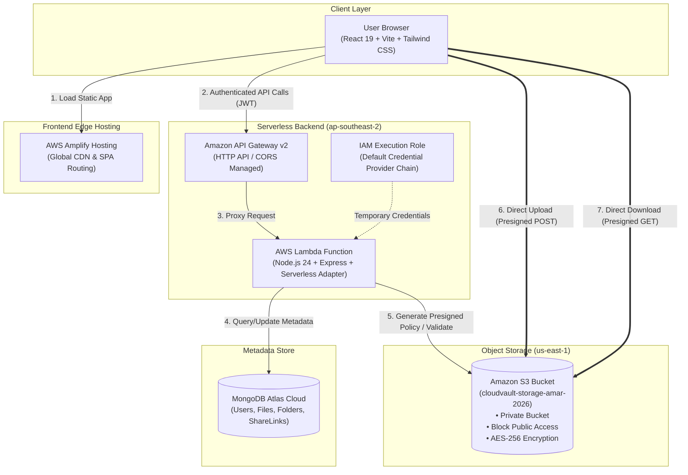
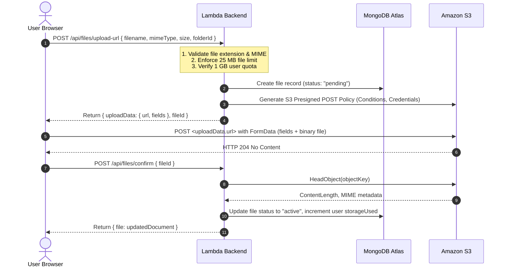
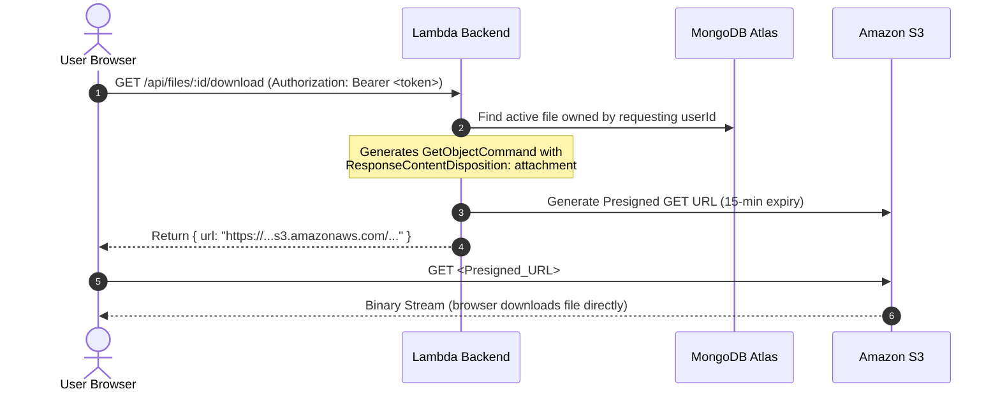

# CloudVault ☁️
### Production-Grade Serverless Cloud Storage & File Sharing Platform

[](https://main.d76gjzk4d8q8b.amplifyapp.com)
[](https://tnn1ahid34.execute-api.ap-southeast-2.amazonaws.com/api/health)
[](https://aws.amazon.com/s3/)
[](https://www.mongodb.com/cloud/atlas)
[](server/tests)

---

## 📑 Table of Contents

- [Overview](#-overview)
- [System Architecture](#-system-architecture)
- [Key Features](#-key-features)
- [Technology Stack](#-technology-stack)
- [Direct S3 Upload & Download Workflows](#-direct-s3-upload--download-workflows)
- [Production Deployment](#-production-deployment)
- [Security & Tenant Isolation](#-security--tenant-isolation)
- [Testing & Quality Assurance](#-testing--quality-assurance)
- [Local Development Setup](#-local-development-setup)
- [Project Structure](#-project-structure)
- [User Interface & Screenshots](#-user-interface--screenshots)
- [API Reference](#-api-reference)
- [License](#-license)

---

## 🌟 Overview

**CloudVault** is a secure, full-stack, cloud-native file storage and sharing platform engineered with modern serverless architecture. It enables users to upload, organize, search, share, and manage documents, media, and archives with enterprise-grade isolation and zero server streaming bottleneck.

### Core Engineering Highlights:
- **Zero-Compute Streaming Bottleneck**: Files stream directly between the browser and Amazon S3 using cryptographically signed **S3 Presigned POST policies**, keeping Lambda execution durations minimal and eliminating API Gateway 10 MB payload limits.
- **Serverless & Scalable**: Node.js/Express API running on **AWS Lambda** (`nodejs24.x`) behind **Amazon API Gateway HTTP API v2** with managed connection pooling to **MongoDB Atlas**.
- **Cross-Region Decoupling**: Compute runs in Sydney (`ap-southeast-2`) while storage is securely maintained in N. Virginia (`us-east-1`) via dynamic region resolution and execution roles.
- **Strict Tenant Isolation**: User files are partitioned in S3 under dedicated user prefixes (`users/{userId}/*`) and guarded by database ownership assertions and JWT authorization.
- **Quota & Lifecycle Enforcement**: Real-time quota calculation (1 GB per user) encompassing active and pending uploads, paired with a two-phase deletion lifecycle (Trash recovery and permanent purge).

---

## 🏗 System Architecture



---

## ✨ Key Features

| Feature | Description |
|---|---|
| **Authentication & Session** | Secure user registration and login with `bcrypt` (10 salt rounds) and stateless `jsonwebtoken` Bearer tokens. |
| **Direct Browser-to-S3 Upload** | Files upload directly to Amazon S3 via presigned POST policies with file-type and 25 MB size constraint policies. |
| **Secure Presigned Downloads** | Downloads generate time-limited (15-minute) signed GET URLs with forced `attachment; filename="..."` disposition. |
| **Hierarchical Folders** | Create, rename, nest, and delete folders with dynamic breadcrumb navigation. |
| **Search, Filter & Sort** | Real-time case-insensitive search, multi-field sorting (Date, Name, Size), and quick filter views. |
| **Starred & Recent Views** | Toggle star bookmarks on important documents; dedicated views for starred and recently uploaded files. |
| **Two-Stage Deletion (Trash)** | Soft delete files to Trash (`isDeleted: true`), restore accidentally deleted files, or permanently delete them from S3. |
| **Time-Limited File Sharing** | Generate cryptographically signed public share links with customizable expiration (`1h`, `24h`, `7d`). |
| **Storage Quota Enforcement** | 1 GB storage limit per user, calculated dynamically from active files and recent in-flight pending uploads. |
| **Automatic Direct Fallback** | Transparent fallback to backend multipart upload if client S3 direct upload encounters strict local network or CORS blocks. |
| **Strict File Validation** | Client-side and server-side validation against blocked dangerous extensions (`.exe`, `.sh`, `.bat`, etc.) and allowed MIME types. |

---

## 🛠 Technology Stack

### Frontend
- **Framework**: React 19 (`react` 19.3.1, `react-dom` 19.3.1)
- **Build Tool**: Vite 8 (`vite` 8.3.5)
- **Styling**: Tailwind CSS v4 (`@tailwindcss/vite` 4.3.3)
- **Routing**: React Router DOM v7 (`react-router-dom` 7.18.5)
- **Icons**: Lucide React (`lucide-react` 1.66.0)
- **HTTP Client**: Axios (`axios` 1.21.0)
- **Hosting**: AWS Amplify Hosting

### Backend & Cloud Compute
- **Runtime**: Node.js 22 (local dev) / Node.js 24 (`nodejs24.x` in AWS Lambda)
- **Web Framework**: Express.js (`express` 4.21.2)
- **Serverless Adapter**: `@codegenie/serverless-express` 4.16.0
- **API Management**: Amazon API Gateway (HTTP API v2)
- **Infrastructure as Code**: AWS Serverless Application Model (AWS SAM `template.yaml`)

### Storage & Database
- **Object Storage**: Amazon S3 via AWS SDK for JavaScript v3 (`@aws-sdk/client-s3`, `@aws-sdk/s3-presigned-post`, `@aws-sdk/s3-request-presigner` 3.731.1)
- **Database & ODM**: MongoDB Atlas Cloud with Mongoose (`mongoose` 8.9.5)
- **File Upload Parsing**: Formidable (`formidable` 3.5.2)

### Security & Utilities
- **Authentication**: JWT (`jsonwebtoken` 9.0.2) + Bcrypt (`bcryptjs` 2.4.3)
- **Request Validation**: Zod (`zod` 3.24.1)
- **Rate Limiting**: `express-rate-limit` 7.5.0
- **Security Headers & CORS**: `helmet` 8.0.0, `cors` 2.8.5
- **Unique Identifiers**: `uuid` 11.0.5

### Quality Assurance & Testing
- **Test Framework**: Vitest 3.2.7 (`vitest`)
- **HTTP Testing**: Supertest 7.0.0 (`supertest`)
- **Linter**: Oxlint 1.89.0 (`oxlint`)

---

## 🔄 Direct S3 Upload & Download Workflows

### 1. Upload Workflow (Two-Phase Presigned POST)



### 2. Download Workflow (Presigned GET)



---

## 🚀 Production Deployment

| Service | Region | Role / Configuration |
|---|---|---|
| **AWS Amplify** | Global Edge | Hosts static React SPA, manages automated Git CI/CD deployments, and handles SPA URL rewrites. |
| **Amazon API Gateway** | `ap-southeast-2` | HTTP API v2 providing managed HTTPS endpoints, automated CORS, and direct Lambda proxy integration. |
| **AWS Lambda** | `ap-southeast-2` | Executes the Express.js backend on `nodejs24.x`. Reuses database connection pool across invocations. |
| **IAM Execution Role** | `ap-southeast-2` | Grants Lambda least-privilege permissions to S3 (`PutObject`, `GetObject`, `DeleteObject`) using the default AWS credential provider chain. |
| **Amazon S3** | `us-east-1` | Stores all encrypted file objects (`cloudvault-storage-amar-2026`). Configured with Block Public Access and AES-256 encryption. |
| **MongoDB Atlas** | AWS Cloud | Multi-AZ cluster hosting collections for `users`, `files`, `folders`, and `sharelinks`. |

### Live Endpoints
- **Production Web Application**: [https://main.d76gjzk4d8q8b.amplifyapp.com](https://main.d76gjzk4d8q8b.amplifyapp.com)
- **Backend Health Check**: [https://tnn1ahid34.execute-api.ap-southeast-2.amazonaws.com/api/health](https://tnn1ahid34.execute-api.ap-southeast-2.amazonaws.com/api/health)

---

## 🔒 Security & Tenant Isolation

- **Private S3 Bucket**: All public read/write access is blocked via S3 Block Public Access (`BlockPublicAcls`, `BlockPublicPolicy`, `IgnorePublicAcls`, `RestrictPublicBuckets`). Direct unauthenticated requests to S3 return `403 Forbidden` or `400 Bad Request`.
- **User-Partitioned S3 Keys**: Object keys are structured as `users/${userId}/${uuidv4()}` ensuring physical separation across tenants.
- **Server-Side Encryption**: All uploaded objects enforce Amazon S3 managed AES-256 server-side encryption (`ServerSideEncryption: 'AES256'`).
- **No Long-Term Credentials in Lambda**: Lambda uses its IAM Execution Role credentials through the AWS SDK default credential provider chain. No static access keys exist in production environment variables.
- **Cross-Region Decoupled Region Handling**: Uses `S3_REGION=us-east-1` for S3 clients without modifying Lambda's reserved runtime `AWS_REGION` (`ap-southeast-2`).
- **Security Headers & Protection**: `helmet` enforces strict HTTP headers (`X-Content-Type-Options`, `X-Frame-Options`, `Strict-Transport-Security`).

---

## 🧪 Testing & Quality Assurance

### 1. Automated Test Suite (Vitest)
CloudVault includes 40 comprehensive unit and integration tests spanning:
- S3 Client service configuration and credential sanitization
- User registration, login, token verification, and password rejection
- Presigned upload URL generation and metadata validation
- Share link generation and public token resolution
- Lambda serverless-express adapter and API Gateway event proxying
- Live cross-region S3 integration tests (PutObject, GetObject, HeadObject, DeleteObject)

```bash
npm test --prefix server
```

```text
 ✓ tests/s3Service.test.js (5 tests)
 ✓ tests/shares.test.js (6 tests)
 ✓ tests/lambda.test.js (6 tests)
 ✓ tests/files.test.js (9 tests)
 ✓ tests/auth.test.js (8 tests)
 ✓ tests/s3Integration.test.js (6 tests)

 Test Files  6 passed (6)
      Tests  40 passed (40)
```

### 2. Live Production Verification (22/22 Passing)
An end-to-end verification script tested the live deployed production environment:

| Category | Tests Executed | Status |
|---|---|---|
| **Health & Connectivity** | Production Health Check | **200 OK — PASS** |
| **Authentication** | Register User 1, Login User 1, Register User 2 | **PASS** |
| **Direct S3 Upload** | Request Presigned POST, S3 Binary Upload, Confirm Upload | **204 / 200 — PASS** |
| **Metadata Integrity** | List Files, Verify File Size, MIME & Name in MongoDB | **200 OK — PASS** |
| **Retrieval & Content** | Presigned GET Download, Byte-for-Byte Content Match | **200 OK — PASS** |
| **Tenant Isolation** | User 2 attempting to download User 1 file | **404 Not Found — PASS** |
| **Lifecycle Operations** | Rename, Star, Move to Trash, Verify Isolation, Restore, Permanent Delete | **PASS** |
| **Security Boundaries** | Missing Auth (401), Invalid Token (401), .exe Block (400), Oversize File (400) | **PASS** |

---

## 💻 Local Development Setup

### Prerequisites
- [Node.js](https://nodejs.org/) v20.x or v22.x
- [MongoDB Atlas](https://www.mongodb.com/cloud/atlas) account or local MongoDB instance
- (Optional for live S3 upload) AWS account with an S3 bucket

### 1. Clone the Repository
```bash
git clone https://github.com/Amar3013/CloudVault.git
cd CloudVault
```

### 2. Configure & Run Backend
```bash
cd server
npm install

# Copy environment template
cp .env.example .env
```

Edit `server/.env`:
```env
PORT=3000
NODE_ENV=development
MONGODB_URI=mongodb+srv://<username>:<password>@cluster0.mongodb.net/cloudvault?retryWrites=true&w=majority
JWT_SECRET=your_jwt_secret_key_at_least_64_characters_long
S3_REGION=us-east-1
S3_BUCKET_NAME=your-s3-bucket-name
AWS_ACCESS_KEY_ID=your_aws_access_key
AWS_SECRET_ACCESS_KEY=your_aws_secret_key
ALLOWED_ORIGINS=http://localhost:5173
MAX_FILE_SIZE=26214400
STORAGE_QUOTA=1073741824
```

Start the backend:
```bash
npm run dev
# Server running at http://localhost:3000
```

### 3. Configure & Run Frontend
In a new terminal window:
```bash
cd client
npm install

# Copy environment template
cp .env.example .env
```

Start the frontend:
```bash
npm run dev
# Local app running at http://localhost:5173
```

---

## 📂 Project Structure

```text
CloudVault/
├── .env.example                  # Root environment variables template
├── .gitignore                    # Git exclusion rules (credentials, node_modules, dist)
├── amplify.yml                   # AWS Amplify Monorepo Build Specification
├── template.yaml                 # AWS SAM CloudFormation Infrastructure as Code
│
├── client/                       # React 19 Frontend
│   ├── .env.example              # Frontend environment template
│   ├── index.html                # HTML entry point
│   ├── package.json              # Frontend dependencies and scripts
│   ├── vite.config.js            # Vite configuration with Tailwind CSS v4
│   └── src/
│       ├── components/           # UI components (FileIcon, Modal, UploadButton)
│       ├── context/              # AuthContext (JWT management & session state)
│       ├── hooks/                # useFileUpload (upload state & progress)
│       ├── layouts/              # DashboardLayout (Sidebar, navigation, mobile drawer)
│       ├── pages/                # LandingPage, LoginPage, RegisterPage, DashboardPage,
│       │                         # MyFilesPage, StarredPage, SharedPage, TrashPage, etc.
│       ├── services/             # Centralized Axios client & FileService
│       └── utils/                # formatters.js (file sizes, dates, MIME sanitization)
│
├── server/                       # Node.js / Express Backend
│   ├── .env.example              # Backend environment template
│   ├── package.json              # Backend dependencies and scripts
│   ├── app.js                    # Express application setup and route mounting
│   ├── lambda.js                 # AWS Lambda handler (serverless-express adapter)
│   ├── config/
│   │   ├── aws.js                # AWS SDK S3 client & dynamic region resolver
│   │   └── database.js           # Mongoose cached connection for Lambda
│   ├── controllers/              # Business logic (auth, files, folders, shares, dashboard)
│   ├── middleware/               # authenticate, errorHandler, Zod validate
│   ├── models/                   # Mongoose schemas (User, File, Folder, ShareLink)
│   ├── routes/                   # REST route definitions (/api/auth, /api/files, etc.)
│   ├── services/                 # s3Service.js (Presigned POST/GET, HeadObject, DeleteObject)
│   └── tests/                    # Vitest automated test suites
```

---

## 📸 User Interface & Screenshots

> *Screenshots from the production deployment of CloudVault:*

| Dashboard Overview | File Management & S3 Upload |
| :---: | :---: |
|  | *Upload progress with live direct-to-S3 progress bar* |

*(Note: Additional full-resolution UI screenshots for the Files Grid, Trash Management, and Sharing modal can be added to `docs/screenshots/`)*

---

## 📡 API Reference

All protected routes require the `Authorization: Bearer <JWT>` header.

### Authentication (`/api/auth`)
| Method | Endpoint | Description |
|---|---|---|
| `POST` | `/api/auth/register` | Register new user account and return JWT |
| `POST` | `/api/auth/login` | Authenticate user credentials and return JWT |
| `GET` | `/api/auth/me` | Retrieve current authenticated user profile |
| `POST` | `/api/auth/logout` | Client session termination |

### Files (`/api/files`)
| Method | Endpoint | Description |
|---|---|---|
| `GET` | `/api/files` | List active files with pagination, search, and sorting |
| `POST` | `/api/files/upload-url` | Generate S3 presigned POST policy and pending record |
| `POST` | `/api/files/confirm` | Verify S3 upload via `HeadObject` and activate file |
| `POST` | `/api/files/upload` | Direct fallback multipart upload through backend |
| `GET` | `/api/files/:id/download` | Generate time-limited presigned S3 GET URL |
| `PATCH` | `/api/files/:id` | Update file (rename or toggle star bookmark) |
| `DELETE` | `/api/files/:id` | Soft delete file (moves to Trash) |
| `POST` | `/api/files/:id/restore` | Restore file from Trash |
| `DELETE` | `/api/files/:id/permanent`| Permanently delete object from S3 and MongoDB |
| `POST` | `/api/files/:id/share` | Generate public share link (`1h`, `24h`, `7d`) |

### Folders & System
| Method | Endpoint | Description |
|---|---|---|
| `GET` | `/api/folders` | List folders within parent directory |
| `POST` | `/api/folders` | Create a new folder |
| `GET` | `/api/dashboard` | Get storage quota metrics and file category counts |
| `GET` | `/api/health` | Service health status and uptime |

---

## 📄 License

This project is licensed under the [MIT License](LICENSE).
