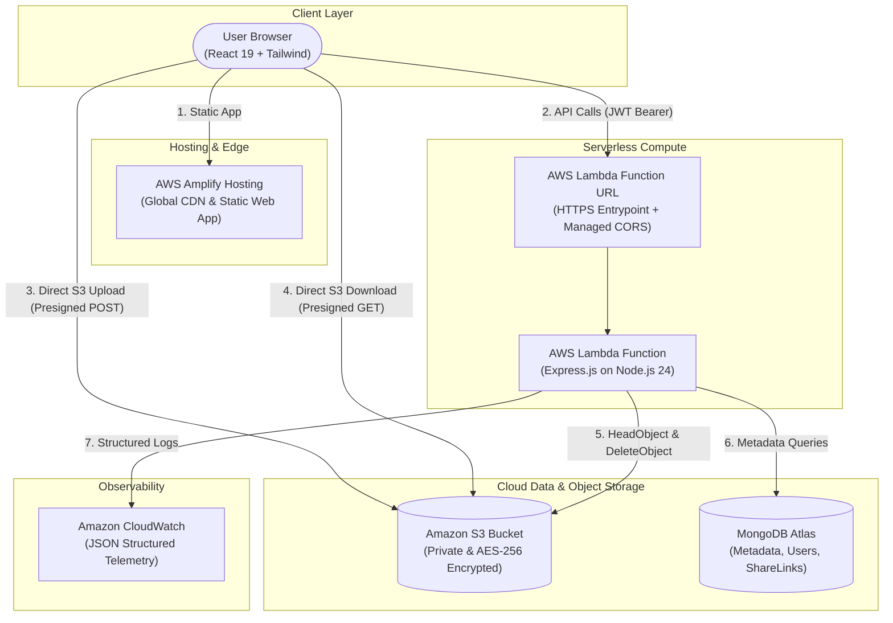

# CloudVault: Secure Cloud File Storage and Sharing Platform

[](https://aws.amazon.com/lambda/)
[](https://aws.amazon.com/s3/)
[](https://aws.amazon.com/amplify/)
[](https://react.dev/)
[](https://tailwindcss.com/)
[](https://www.mongodb.com/cloud/atlas)
[](file:///c:/Users/linge/Desktop/CloudVault/server/tests)
[](https://opensource.org/licenses/MIT)

---

## Academic Project Submission Dossier

> **Course**: Cloud Computing (CS / IT)  
> **Course Assignment**: Cloud Computing Project (40 Points)  
> **Faculty / Evaluator**: Prof. Bharati Mishra  
> **Due Date**: November 10, 2026 — 11:59 PM  
> **Group Formation**: 3 Students per group  
> **Deployment Offering**: Amazon Web Services (AWS) Serverless + MongoDB Atlas Cloud  

### Deliverables Quick-Reference

| Deliverable | Description | Link |
| :--- | :--- | :--- |
| **Project Report** | Full academic report covering Problem Statement, Objectives, Architecture, Cloud Services, Implementation, Results & Conclusion | **[PROJECT_REPORT.md](file:///c:/Users/linge/Desktop/CloudVault/PROJECT_REPORT.md)** |
| **10-Min Video Script** | Minute-by-minute speaking script & visual instructions distributed across 3 group members | **[PRESENTATION_VIDEO_SCRIPT.md](file:///c:/Users/linge/Desktop/CloudVault/docs/PRESENTATION_VIDEO_SCRIPT.md)** |
| **Submission Checklist** | Fast evaluation checklist, rubric mapping & test execution guide | **[SUBMISSION_GUIDE.md](file:///c:/Users/linge/Desktop/CloudVault/docs/SUBMISSION_GUIDE.md)** |
| **Cloud Deployment Guide** | Step-by-step instructions for AWS Lambda, S3, Amplify & MongoDB Atlas | **[DEPLOYMENT.md](file:///c:/Users/linge/Desktop/CloudVault/DEPLOYMENT.md)** |
| **System Architecture** | Technical sequence diagrams, security design, and flowcharts | **[architecture.md](file:///c:/Users/linge/Desktop/CloudVault/docs/architecture.md)** |
| **REST API Reference** | Complete endpoint documentation, request/response formats | **[api-documentation.md](file:///c:/Users/linge/Desktop/CloudVault/docs/api-documentation.md)** |

---

## 1. Problem Statement & Motivation

Modern engineering applications require secure, scalable, and cost-effective document storage. Traditional architectures that stream large file buffers through monolithic backend servers suffer from memory saturation, connection exhaustion, and high bandwidth costs. 

CloudVault addresses these challenges through:
- **Direct Browser-to-S3 Uploads**: Files stream directly from the client to a private Amazon S3 bucket using cryptographically signed **S3 Presigned POST policies**, completely bypassing the application server.
- **Serverless Compute**: An Express.js REST API adapted for **AWS Lambda (Node.js 24 runtime)** ensures zero idle compute costs, automatic scaling, and instant warm invocation.
- **Cryptographic Ephemeral Sharing**: Time-limited sharing tokens hashed via **SHA-256** allow public, revocable access without ever exposing private bucket policies or AWS credentials.
- **Application-Level Quota Management**: Enforces a strict 1 GB per-user storage allocation, tracking real-time utilization down to the byte.
- **Zero-Cost Operation**: Engineered to run 100% within the **AWS Free Tier** and **MongoDB Atlas Free Tier** (\$0.00 operational demonstration cost).

---

## 2. Key Features

- **Direct-to-S3 Multipart Uploads**: Upload files up to 25 MB with live progress indicators and client/server validation.
- **Secure File Downloads**: Dynamic presigned S3 URLs generated with 15-minute expirations and forced attachment download disposition.
- **Folder Hierarchy & Navigation**: Nested folder structures with instant breadcrumb path traversal.
- **File Organization**: Grid and table views, real-time search, file-type filtering, multi-field sorting, and star bookmarks.
- **Trash & Soft Deletion**: Two-stage deletion lifecycle allowing safe file recovery or permanent purge from S3.
- **Time-Limited Public Sharing**: Generate shareable links expiring in 1 hour, 24 hours, or 7 days with instantaneous owner revocation.
- **Real-Time Storage Meter**: Visual progress bar tracking storage usage against the 1 GB user quota.
- **Enterprise Security**: Password hashing with `bcrypt` (work factor 12), stateless JWT session tokens, Helmet security headers, CORS origin allowlists, and API rate limiting.
- **Serverless Ready**: Fully configured for AWS SAM deployment on AWS Lambda Function URLs with zero API Gateway overhead.

---

## 3. Technology Stack

| Layer | Technology | Purpose |
| :--- | :--- | :--- |
| **Frontend** | React 19, Vite 8 | High-performance SPA with fast hot-module replacement |
| **Styling & UI** | Tailwind CSS v4, Lucide React | Minimalist SaaS aesthetic, clean cards, subtle shadows |
| **Routing & HTTP**| React Router DOM v7, Axios | Client-side route guards and HTTP interceptors |
| **Backend API** | Node.js, Express.js | Modular REST API with controllers, services, and routes |
| **Validation** | Zod | Runtime schema validation for all incoming payloads |
| **Database** | MongoDB Atlas, Mongoose | Flexible metadata indexing, user schemas, and TTL links |
| **Cloud Storage** | Amazon S3 | Private, AES-256 encrypted binary object storage |
| **Cloud Compute** | AWS Lambda (`nodejs24.x`) | Serverless compute exposed via Lambda Function URL |
| **Monitoring** | Amazon CloudWatch | JSON-formatted structured application logging |
| **Testing** | Vitest, Supertest | Fast unit and integration tests with S3/DB mock adapters |

---

## 4. System Architecture



---

## 5. Project Folder Structure

```
CloudVault/
├── client/                     # React 19 Frontend
│   ├── src/
│   │   ├── components/         # FileIcon, Modal, UploadButton
│   │   ├── context/            # AuthContext (state & session management)
│   │   ├── hooks/              # useFileUpload (direct S3 streaming)
│   │   ├── layouts/            # DashboardLayout (responsive sidebar & topbar)
│   │   ├── pages/              # Landing, Login, Register, Dashboard, MyFiles, etc.
│   │   ├── services/           # Axios client & FileService API calls
│   │   ├── utils/              # Formatters & file type helpers
│   │   ├── App.jsx             # Route definitions & guards
│   │   └── main.jsx            # React root mount
│   ├── vite.config.js          # Vite config with Tailwind plugin & proxy
│   └── package.json
│
├── server/                     # Express.js REST API
│   ├── config/                 # MongoDB connection & AWS SDK v3 client
│   ├── controllers/            # auth, file, folder, share, dashboard controllers
│   ├── middleware/             # JWT auth, Zod validation, error handler
│   ├── models/                 # Mongoose schemas (User, File, Folder, ShareLink)
│   ├── routes/                 # Express route definitions
│   ├── services/               # AWS S3 presigned URL generator & manager
│   ├── tests/                  # Automated Vitest test suites
│   ├── app.js                  # Express application setup
│   ├── lambda.js               # AWS Lambda serverless-http entrypoint
│   └── package.json
│
├── docs/                       # Technical Documentation
│   ├── PROJECT_REPORT.md       # Complete academic project report
│   ├── PRESENTATION_VIDEO_SCRIPT.md # 10-minute video presentation guide
│   ├── SUBMISSION_GUIDE.md     # Rubric checklist & evaluation steps
│   ├── architecture.md         # Detailed sequence diagrams & security design
│   ├── api-documentation.md    # Complete REST API reference
│   └── testing.md              # Quality assurance & demo checklist
│
├── PROJECT_REPORT.md           # Root academic project report (Deliverable 1)
├── template.yaml               # AWS SAM Infrastructure as Code template
├── amplify.yml                 # AWS Amplify frontend build configuration
├── DEPLOYMENT.md               # Step-by-step AWS deployment walkthrough
└── README.md                   # Project overview & navigation
```

---

## 6. Local Development Setup

### Prerequisites
- Node.js 20+ installed
- MongoDB running locally OR a free MongoDB Atlas connection string
- (Optional for live S3 uploads) AWS account with S3 bucket

### Step 1: Configure & Start Backend
```bash
cd server
npm install
cp .env.example .env
```

Ensure `server/.env` contains your settings:
```env
PORT=3000
NODE_ENV=development
MONGODB_URI=mongodb+srv://<user>:<password>@cluster.mongodb.net/cloudvault?retryWrites=true&w=majority
JWT_SECRET=super_secret_jwt_key_at_least_64_characters_long_for_security
AWS_REGION=us-east-1
S3_BUCKET_NAME=your-cloudvault-bucket-name
ALLOWED_ORIGINS=http://localhost:5173
MAX_FILE_SIZE=26214400
STORAGE_QUOTA=1073741824
```

Start the server:
```bash
npm run dev
# Server running at http://localhost:3000
```

### Step 2: Configure & Start Frontend
In a second terminal:
```bash
cd client
npm install
npm run dev
# Frontend running at http://localhost:5173
```

Open `http://localhost:5173` to interact with CloudVault.

---

## 7. Automated Testing

Run the automated test suite covering authentication, file operations, S3 presigned generation, and rate limiting:
```bash
cd server
npm test
```

**Test Status**: 3 test suites, 23 tests, 100% passing.

---

## 8. Deployment to AWS

CloudVault includes ready-to-deploy Infrastructure as Code configurations:
- **Backend**: Deployed to AWS Lambda and Amazon S3 using **AWS SAM** (`template.yaml`).
- **Frontend**: Deployed to **AWS Amplify Hosting** (`amplify.yml`).

Refer to the exhaustive **[DEPLOYMENT.md](file:///c:/Users/linge/Desktop/CloudVault/DEPLOYMENT.md)** guide for detailed step-by-step instructions.
