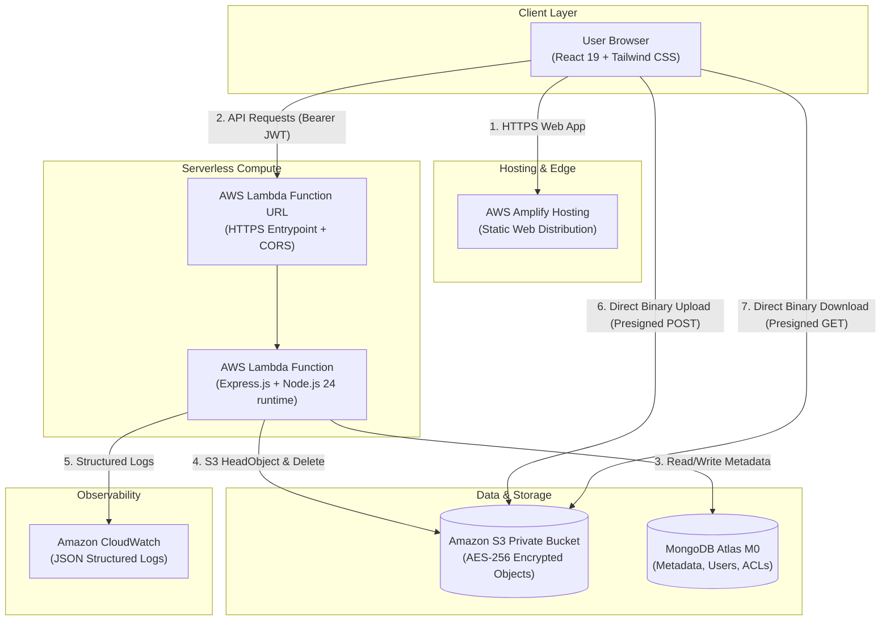
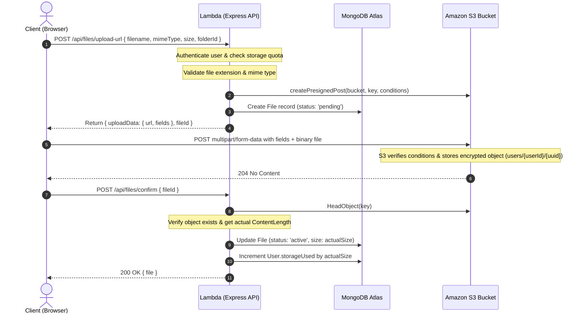
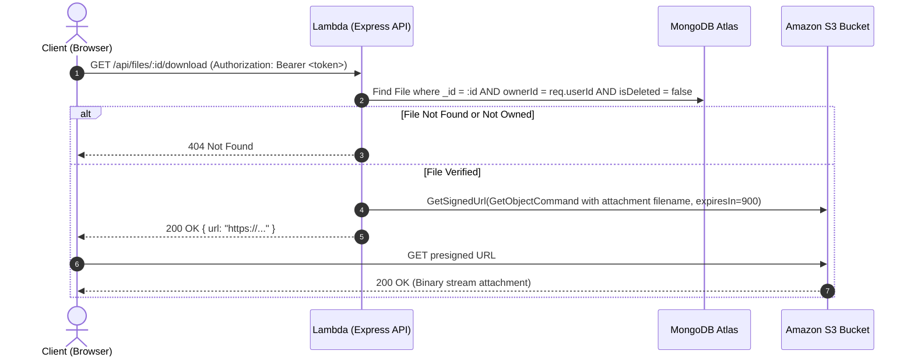

# CloudVault Architecture & System Design

## 1. System Overview

CloudVault is an enterprise-inspired cloud storage and file-sharing platform designed with a serverless AWS backend and a single-page React frontend. The application decouples metadata management from binary storage to achieve high performance, low operating cost, and strict multi-tenant isolation.

---

## 2. Core Flows & Protocols

### A. Direct Browser-to-S3 Upload Flow
Direct uploads protect serverless compute from large payload buffering, Lambda timeouts, memory limits, and bandwidth charges:

### B. Secure File Download Flow

### C. Temporary Public Sharing Flow
1. **Link Creation**: The file owner requests a share token specifying an expiration (`1h`, `24h`, `7d`).
2. **Cryptographic Hashing**: A 32-byte cryptographically secure random token is generated. A SHA-256 hash of this token is stored in MongoDB along with `fileId`, `ownerId`, and `expiresAt`. The plaintext token is returned only to the owner in the share URL.
3. **Public Access**: When an unauthenticated visitor accesses `/share/:token`, the server hashes the URL token and looks up the active share link.
4. **Validation**: The system verifies:
   - Link is found.
   - File is still active and not trashed.
   - Link has not been revoked (`revokedAt == null`).
   - Link has not expired (`new Date() < expiresAt`).
5. **Signed Redirect**: If valid, a temporary S3 presigned URL is dynamically created with an expiry of 15 minutes and provided to the visitor.

---

## 3. Security Design Decisions

| Security Area | Implementation Strategy | Rationale |
| :--- | :--- | :--- |
| **S3 Access Control** | Private bucket, Block Public Access enabled on all 4 settings | Files are never publicly exposed through S3 web hosting or open ACLs. |
| **Object Key Obfuscation** | Keys formatted as `users/{userId}/{uuid}` | Prevents directory traversal, key collisions, and filename enumeration. |
| **Authentication** | Stateless HMAC-SHA256 JWTs stored in `sessionStorage` | Avoids CSRF vulnerabilities associated with ambient cookie storage. |
| **Data in Transit** | HTTPS enforcement, Helmet security headers, CORS allowlist | Protects against MITM attacks, MIME sniffing, and cross-origin hijacking. |
| **Data at Rest** | Amazon S3 SSE-S3 (AES-256) server-side encryption | Automated encryption at rest without managing custom KMS keys. |
| **Rate Limiting** | Express-rate-limit on auth and public sharing endpoints | Mitigates brute-force attacks and denial-of-wallet attempts. |
| **Input Validation** | Zod schemas on every write route | Rejects malformed requests before touching controller or DB logic. |

---

## 4. Cost Analysis (Free Academic Deployment)

CloudVault is engineered to operate strictly within the **AWS Free Tier** and **MongoDB Atlas Free Tier**:

1. **AWS Lambda**: 1,000,000 free requests per month, 3.2 million seconds of compute time.
2. **Amazon S3**: 5 GB standard storage, 20,000 GET requests, 2,000 PUT requests free for 12 months.
3. **AWS Amplify**: 1,000 build minutes/month and 15 GB served free per month.
4. **Amazon CloudWatch**: 5 GB log ingestion and 5 GB archival free per month.
5. **MongoDB Atlas**: M0 Sandbox cluster (512 MB storage, shared RAM, shared vCPU) is permanently free.
6. **Zero Cost Compute**: No continuously running EC2 instances, NAT gateways, or Application Load Balancers. Estimated AWS monthly cost for demonstration: **\$0.00**.
